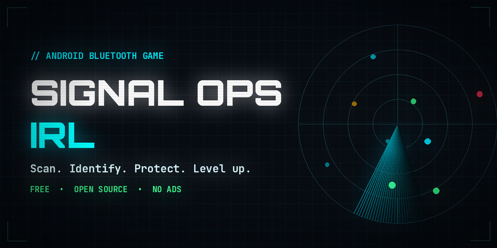
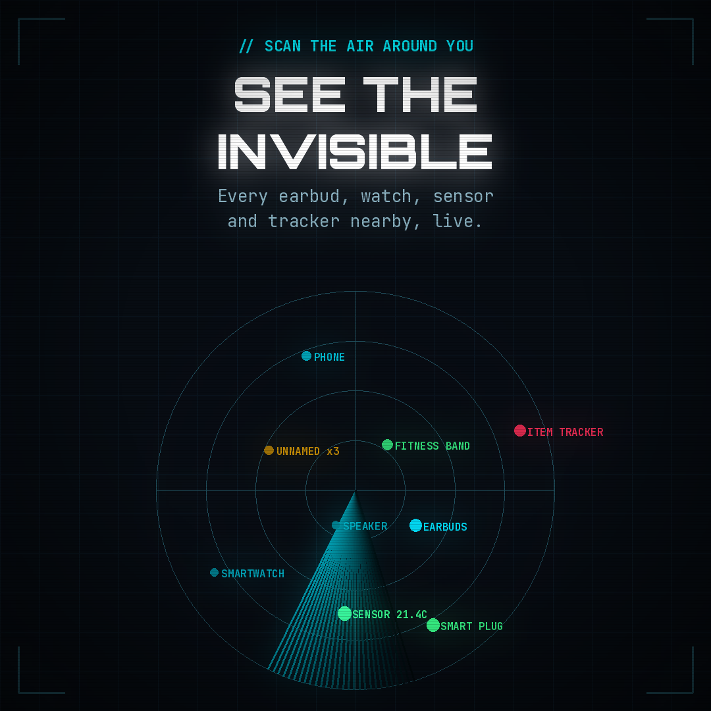
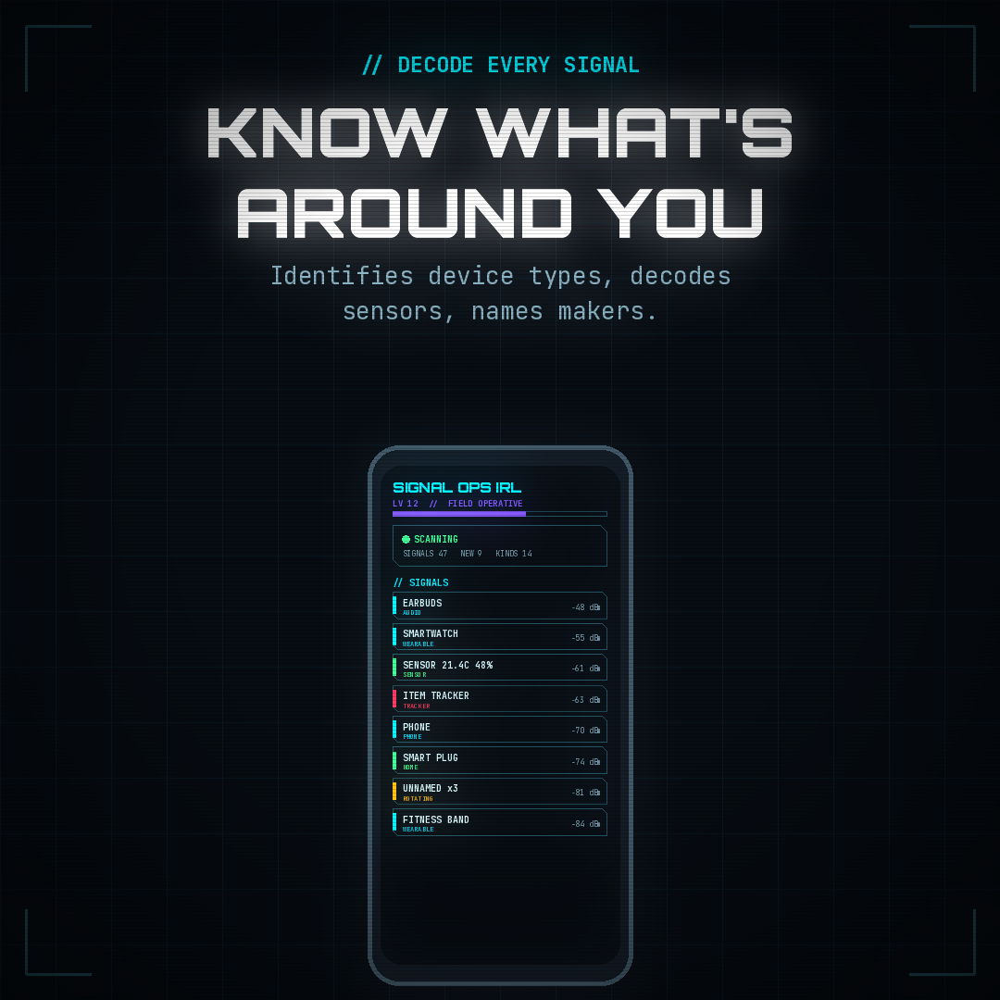
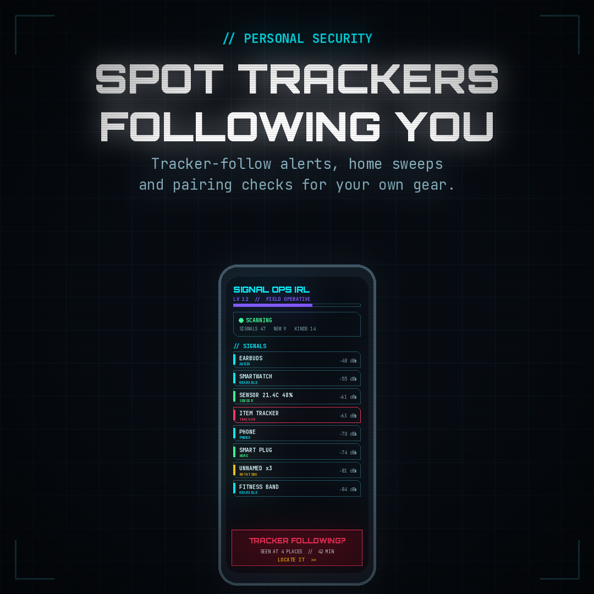
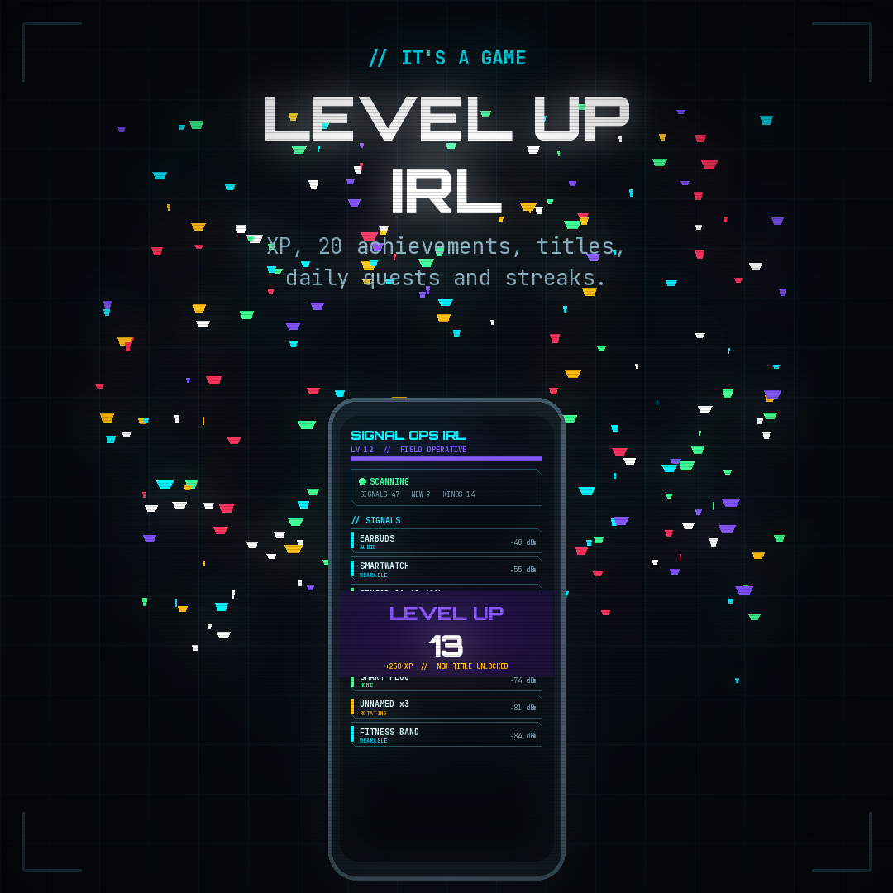

# Signal OPS IRL



[](LICENSE)

[](https://buymeacoffee.com/Tonyispht)

**Turn the Bluetooth world around you into a game.**

Signal OPS IRL is an Android app that listens to nearby Bluetooth Low Energy (BLE) and Classic Bluetooth broadcasts and turns
them into a retro "field intel" terminal, complete with XP, levels, achievements, daily quests and a device collection to fill.
It's also a practical way to learn how Bluetooth works and to check what your own devices are broadcasting.

> **Please use it responsibly.** Signal OPS IRL is intended for recreational, educational and personal-security use only.
> Every user must accept the [Terms of Responsible Use](#terms-of-responsible-use) before the app will scan.

<p align="center">
  
  
  
  
</p>

▶️ **Watch the trailer:** [landscape](media/signal-ops-irl-promo.mp4) · [vertical](media/signal-ops-irl-promo-vertical.mp4)

---

## Features

### Scanning
- **Continuous or burst scanning:** scan non-stop, or scan for 3–15 s and then pause for 10–120 s to save battery.
- **Live Signals list** with signal strength, colour-coded proximity and a radar view.
- **BLE 5 extended advertising** and **Classic Bluetooth discovery** to find more devices.
- **External USB Bluetooth adapter** support (including Realtek firmware loading) for better range.
- **Runs in a foreground service**, with an optional keep-screen-on mode for reliable results.

### Identifying devices
- **Device database:** recognises common device types (phones, earbuds, watches, trackers, sensors and more) from what they broadcast.
- **Advertising data viewer:** decodes flags, service UUIDs, manufacturer data, Apple Continuity messages and more.
- **Sensor readouts:** decodes broadcast measurements from sensors such as Ruuvi tags without connecting.
- **Built-in Bluetooth database:** the full Bluetooth SIG company, service UUID and appearance lists plus the IEEE MAC prefix registry ship inside the app, so devices are identified offline from the first launch.
- **Custom names** for the devices you recognise, and grouping for devices that rotate their addresses.

### Personal security
- **Tracker-follow detection:** warns you when an AirTag, Tile or similar tracker keeps showing up around you.
- **Pairing check:** flags devices that would likely pair without a PIN (Just Works) so you can audit your *own* gear.
- **Watchlist alerts:** add names or MAC addresses and get a sound, vibration, flashing border and notification when one appears.
- **Hot/cold locating:** walk toward a device you've lost and follow the signal strength.
- **PIN lock** for your watchlist.

### The game
- **XP and levels** for discovering devices, identifying new kinds, locating, naming and decoding sensors.
- **20 achievements** and **14 unlockable titles**.
- **Daily quests, streaks and a login calendar.**
- **The Signal Dex**, a device collection to fill as you identify new types.
- **Movie FX:** boot sequence, CRT power on/off, scanlines, data rain, an oscilloscope and full-screen celebrations (all optional).

### Optional target lists
Ready-made lists you can import for home security sweeps and auditing: **hacking gadgets and card skimmers**, **item
trackers**, and **law-enforcement devices**. See **[target-lists](target-lists/)**.

Full documentation for every feature and setting is in the **[User Guide](docs/USER_GUIDE.md)**.

---

## Requirements

- **Android 8.0 (API 26) or newer.**
- **A real phone.** Emulators don't have a Bluetooth radio.
- Bluetooth turned on. On Android 12 and newer the app asks for the **Nearby devices** permission, and location is only used
  for the speed readout and tracker-follow detection. Android 8–11 require location permission for any Bluetooth scan.

## Building from source

1. Install [Android Studio](https://developer.android.com/studio) (Koala or newer) with **JDK 17**.
2. Clone this repository:
   ```bash
   git clone https://github.com/tonyispht/SignalOpsIRL-for-android.git
   ```
3. Open the folder in Android Studio and let Gradle sync.
4. Turn on **Developer options** and **USB debugging** on your phone, plug it in, and press **Run**.

To make an installable APK, use **Build > Build Bundle(s) / APK(s) > Build APK(s)**.

---

## Privacy

- **Everything stays on your phone.** The app has no accounts, no analytics and no ads, and it doesn't upload what it scans.
- Location, when enabled, is kept in memory only and is never stored.
- The only network request is the optional, user-triggered update of the public IEEE manufacturer list (a full copy is already built in).

## Terms of Responsible Use

The first time it opens, the app shows these terms and won't scan until they're accepted. You can read them again any time in
**Settings > ABOUT > TERMS OF USE**. In short:

1. **Intended use:** a game and a learning tool for your own surroundings and devices. It isn't a professional or safety-critical tool.
2. **Respect others' privacy:** never use it to locate, follow, monitor or identify anyone without their consent.
3. **Devices you don't own:** only connect to, probe or test devices you own or have explicit permission to examine.
4. **Follow the law:** you're responsible for complying with the privacy, wireless and computer-access laws where you are.
5. **Accuracy:** identifications and indicators are estimates. If you think you're being tracked or are in danger, contact local authorities.
6. **Safe play:** stay aware of your surroundings and never use it while driving.
7. **No warranty:** the app is provided "as is."

The full text is in [`Terms.kt`](app/src/main/java/com/example/signalopsirl/Terms.kt).

## Support the project

Signal OPS IRL is free, with no ads. If you enjoy it, you can support development at
**[buymeacoffee.com/Tonyispht](https://buymeacoffee.com/Tonyispht)** ☕, or from inside the app in **Settings > ABOUT > SUPPORT THE DEVELOPER**.

## License

Released under the [MIT License](LICENSE). Use of the app is also subject to the Terms of Responsible Use above.

## Disclaimer

Signal OPS IRL only reads information that devices broadcast publicly. Its device classifications, distance estimates and security
indicators are approximations and can be wrong. The developers aren't responsible for how the app is used.
